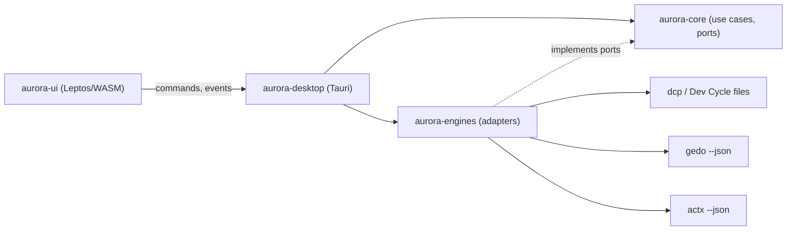

# aurora-dev-suite — Technical Documentation

Entry point to the architecture of aurora-dev-suite. This index is maintained with the
`architecture-docs` skill: the sections between `architecture-docs` markers are
generated by `build_index.py`; the rest is written by hand.

## System Overview

Aurora Dev Suite is a Rust desktop application (Tauri 2 with a Leptos interface) that shows,
for every project the user registers, the state of its development cycle, the work of its
coding agents and the knowledge of its documents. It does not compute any of this itself:
the Dev Cycle Protocol (`dcp`), Gedo (`gedo`) and AnyContext (`actx`) do, and Aurora reads
them through their command lines with versioned JSON.

The workspace is hexagonal. The core holds the domain, the use cases and the ports; the
engine adapters implement the ports; the desktop shell wires them and exposes the use
cases to the interface. Aurora's only own state is the list of registered projects.

## Subsystems

<!-- architecture-docs:subsystems:start -->
| Subsystem | Summary |
|---|---|
| [Aurora Core](docs/architecture/core.md) | Domain model of the suite, the use cases and the ports every engine and surface goes through. |
| [Desktop Shell](docs/architecture/desktop.md) | The Tauri 2 application: composition root, commands exposed to the interface, windows, packaging and updates. |
| [Engine Adapters](docs/architecture/engines.md) | Driven adapters that read the Dev Cycle, Gedo and AnyContext through their command lines, plus stand-in adapters until each contract exists. |
| [User Interface](docs/architecture/ui.md) | The Leptos interface compiled to WebAssembly: views, components and the Aurora Borealis theme. |
<!-- architecture-docs:subsystems:end -->

## Architecture Decision Records

<!-- architecture-docs:adrs:start -->
| ADR | Title | Status | Version | Date |
|---|---|---|---|---|
| [ADR-0005](docs/adr/0005-proprietary-binary-only-distribution-with-levix-licenses.md) | Proprietary binary-only distribution with Levix licenses | proposed |  | 2026-10-27 |
| [ADR-0004](docs/adr/0004-local-first-state-derived-from-the-repositories.md) | Local-first state derived from the repositories | proposed |  | 2026-10-27 |
| [ADR-0003](docs/adr/0003-engines-integrated-only-through-their-command-lines-with-ver.md) | Engines integrated only through their command lines with versioned JSON | proposed |  | 2026-10-27 |
| [ADR-0002](docs/adr/0002-desktop-application-with-tauri-2-and-a-leptos-interface.md) | Desktop application with Tauri 2 and a Leptos interface | proposed |  | 2026-10-27 |
| [ADR-0001](docs/adr/0001-hexagonal-architecture-with-the-engines-behind-ports.md) | Hexagonal architecture with the engines behind ports | proposed |  | 2026-10-27 |
<!-- architecture-docs:adrs:end -->

## How to Update This Documentation

- **A subsystem changed** (behavior, structure, data): edit its page in `docs/architecture/` in place, replacing outdated text.
- **A decision with alternatives and trade-offs**: create an ADR with `new_adr.py` and link it from the subsystem page.
- **A decision that reverses or corrects another**: create a new ADR with `--supersedes` or `--amends`; never rewrite an accepted ADR.
- **A feature was removed**: remove it from the subsystem page; its ADRs stay as history.
- **A release**: nothing here; release notes live in the GitHub releases.
- Run `check_docs.py` before committing.
