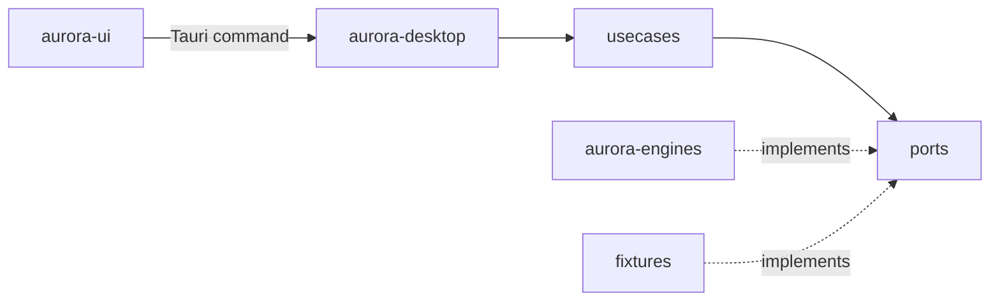

# Aurora Core

Domain model of the suite, the use cases and the ports every engine and surface goes through.

## Responsibilities

- The domain types of projects, engines, settings, features, the development cycle state and a project's Dev Cycle settings, as plain data with serde (`camelCase` on the wire).
- The use cases, one per user action: list, add, rename, remove and relocate a project; read and save the settings; probe an engine and build the engines overview; read a project's cycle state; read, preview and apply a project's Dev Cycle settings.
- The ports the use cases need, as traits.
- The catalog of what each feature needs from each engine.
- Sample data and in-memory ports behind the `fixtures` feature, for every crate's tests and the interface preview.
- It does not run processes, read files or know any UI framework; it compiles to WebAssembly so the interface shares its types.

## Structure

| Module | Holds |
|---|---|
| `domain::project` | `Project`, `ProjectId`, `ProjectName` (trimmed, 1 to 80 characters), `Presence` (present or missing), `ProjectList` with an optional `RegistryNotice` (recovered or read-only), `AddOutcome`, `ProjectError` |
| `domain::engine` | `EngineKind` (`dcp`, `gedo`, `actx`, `dcp-integrations`), `EngineStatus` (ready, installed without contract, degraded with a reason, missing), `EngineReport`, `Capability`, `EngineSettings` (location, time limit) |
| `domain::cycle` | `CycleState` (summary, `NextStep` with its options, `CurrentRelease` with open items, `PlanProgress`, `CandidateRun`, `PullRequestState`, blocking `ItemRef`s, `UntriagedBug`s, findings, read time) and `CycleError` (unavailable with a hint, project missing, timed out, too large, failed, invalid, unsupported with the side to update) |
| `domain::config` | a project's Dev Cycle settings from `dcp config get`: `ProjectConfig` (revision, source, `ConfigSetting`s, findings, read time) with `groups()`; `ConfigSetting` (key, group, description, `ConfigType` with `Other` for unknown types, whether it is set in the file, `ConfigValue` value and default with `Json` for structured values, allowed values, nullable, read-only and its reason) with `editable`, `check` and `parse_input`; `ConfigDraft` (the user's edits, `reset`, `rebase`, `change`); `ConfigChange` (revision and `KeyValue`s), `ConfigOutcome` (applied, revision, `KeyChange`s, diff), `FieldError` and `ConfigError` (the engine failures of `CycleError`, plus rejected, stale and nothing to change) |
| `domain::portfolio` | what the views show of a cycle state: `CyclePhase` (release candidate, implementation, review, planning, idle), `WaitingItem`s by `WaitingKind` (release candidate, pull request, blocking bug, untriaged bug) and `CycleSummary` |
| `domain::inbox` | the Inbox: the `Urgency` of a waiting item (blocks a release, acceptance, review, triage) and the `Inbox` of every project's `InboxEntry`s in order, with its groups and project count |
| `domain::project_view` | what the Project view adds: `CandidateStage` of a release candidate (tests to run, failures to look at, ready for release, released), the `Gate`s by `GateKind` (decision, release candidate acceptance, release), `NextStep::ordered` and the progress of a `PlanProgress` |
| `domain::messages` | messages between projects: `MessageKind` (unknown kinds kept as text), `MessageHeader`, `Message` with its sections, `Conversation` (cycle, round, next round, last message, waiting for the user, the user's requests, unread received messages) with its `ConversationState` (waiting for you; closed when the current cycle ended in a decision or an ack, holds only a notice, or is a tool 0.1 message set to done; otherwise in progress), `needs_attention` and `no_answer_yet` (my last message, not closed, still inside the rounds), `ClosingRecord` with its numbered options, `TemplateSection`, `ProjectInbox` (with `open_count`: conversations waiting for the user or with unread messages) with its `InboxSetup` (ready, not set up with the command, unavailable with the reason), `Draft`, `UserAction` (decide, revise, guide, send, reply, mark seen), `MessagesError`, `PollResult` (with `set_up`: a project without `.aurora/integrations.json` is reported, not skipped), `SetupMemory` (each project's setup as last seen; `note` marks a result changed when it differs); the overview order and the checks before running |
| `domain::settings` | `Settings` (version 2, `ThemeChoice`, per-engine settings with 10 s by default and 60 s for `dcp-integrations`, whose first read of a project fetches every counterpart's inbox; `messages_poll_minutes`, 1 by default, 0 off), `Settings::upgraded` (version 1 files keep a changed limit and raise the old 10 s default of the provider), and `Theme` resolution |
| `domain::feature` | `Feature`, `AvailabilityState` (available, unavailable with what is missing and a hint, not in this release), `EnginesOverview` |
| `ports` | `ProjectRegistry`, `SettingsStore`, `EngineProbe`, `CycleSource`, `ConfigSource`, `MessagesSource` (with `InboxRead` and its `ListedProject` entries) |
| `usecases` | `projects`, `settings`, `engines`, `cycle`, `config`, `messages` |
| `capabilities` | the feature catalog and its evaluation; `usable_dcp` for the cycle state and `usable_dcp_for` for any `dcp` feature (Project settings needs `config`); `usable_for` for any feature's engine (Messages needs `dcp-integrations` with `messages`) |
| `fixtures` | feature `fixtures`: four sample projects (one missing), sample engine reports, `MemoryRegistry`, `MemorySettings`, `FixtureProbe`, three sample cycle states (busy, idle, release candidate) and `FixtureCycleSource`, the sample project settings and `FixtureConfigSource` (in memory, refuses like `dcp`), and `FixtureMessages` (sample conversations in memory, changed by each action) |

## Behavior

The catalog maps each feature to one engine, the capabilities it needs (schema MAJOR 1) and the release that ships it:

| Feature | Engine | Capabilities | Release |
|---|---|---|---|
| Portfolio, Project view, Decision inbox | Dev Cycle (`dcp`) | `diagnose` | v0.2.0 |
| Agent work | Gedo | `radar`, `scope`, `stream` | v0.4.0 |
| Knowledge | AnyContext (`actx`) | `ask`, `workspaces` | v0.5.0 |

A feature is unavailable, with the hint of its engine, while its engine is not ready or lacks a capability; only a ready engine counts, and only the capabilities of the engine the feature names. When everything is there but the feature ships in a later release, it says "not in this release". Errors are values (`thiserror` enums), never panics.

**Cycle state.** `usecases::cycle::cycle_state` asks the `CycleSource` only when the latest `dcp` report is ready with `diagnose` at schema MAJOR 1 and the project's folder is present; otherwise it returns `Unavailable` with the catalog's hint, or `ProjectMissing`, without running anything. The state is read on demand and never stored. It does not depend on the release gate of the catalog: the views of v0.2.0 decide what to show.

**Project settings.** `usecases::config::{read, preview, apply}` call the `ConfigSource` only when the latest `dcp` report has `config` at schema MAJOR 1 and the folder is present; an empty change is `NothingToChange` without running anything, and an apply that wrote nothing is `NothingToChange` too. The interface keeps a `ConfigDraft` over one `ProjectConfig`: an edit back to the current value is dropped, a key not set in the file stays unset until the user picks a different value, and `None` removes a key (back to its default); `change` checks every edit with `ConfigSetting::check` (editable, type, allowed values) and orders it as the settings, carrying the revision read. `dcp` stays the authority: its refusals come back as `FieldError`s, and a stale revision wins as `ConfigError::Stale`. Aurora never reads or writes the configuration file and never commits.

**Messages.** `usecases::messages` asks the `MessagesSource` only when the latest `dcp-integrations` report has `messages` at MAJOR 1 and the project's folder is present. `project_inbox` turns a provider that is missing, a missing folder or a failure into `InboxSetup::Unavailable` with the reason, and `NotSetUp` into the command that sets the project up. The command carries the slug the projects already set up give to the project's repository: `read_inbox` reads each project (in any order, or in parallel) and keeps the projects its registry lists with their URLs and, for a project not set up, its `origin` as the provider reports it; `complete` matches that `origin` against the listed URLs with `repository_key` (no scheme, user, `.git` or trailing slash, `host:owner/name` as `host/owner/name`, lowercase) and falls back to `suggested_slug` of the project's name when none matches (BUG-009). `overview` is `read_inbox` for every project then `complete`; `project_inbox` alone knows no other project, so it suggests the slug from the name; the conversations come in the order of `order_conversations`: waiting for the user, then in a cycle the user asked for, then the rest, the most recent first. `act` checks before anything runs: an empty choice or request, a draft that does not open a conversation, empty required sections of the kind's template (asked from the provider), an empty free message and a body over 256 KiB; `Conversation::reply_kinds` offers only an agreement, an impasse or an ack after three rounds. The provider stays the authority and refuses the same way. `poll` leaves out a project that cannot be polled. Aurora runs no Git and writes no inbox or registry.

**Phase and waiting items.** `CyclePhase::of` takes the first that applies: a release candidate not released, a plan in progress, an open pull request, a current release with open items, otherwise idle (the `dcp.diagnose` reply has no phase field). `WaitingItem::all` lists what waits for the user: the unreleased release candidate (tests to run, failures to look at, or the release to approve), each pull request that needs action, each blocking bug and each untriaged bug; the recommended next step is not counted, since its options point at the same items. Each item also carries a detail (a bug's severity, a candidate's test counts, a pull request's summary and review threads for the user, an untriaged bug's reason) and an `Urgency`: blocking bugs and candidates with failed tests block a release, other unreleased candidates wait for the user's acceptance, pull requests wait for review, untriaged bugs wait for triage. The Portfolio, the Project view and the Inbox share these rules.

**Inbox.** `Inbox::of` takes each project's id, name and `CycleSummary` in the registry's order and sorts the waiting items stably by urgency, so the order is urgency, then project, then the item's order in its project. The protocol's decision (`next.ask`) is not an item: its options point at the same items, and the Inbox total stays equal to the Portfolio's.

**Gates.** `Gate::all` lists the decisions that wait for the user: a decision when the protocol asks (`next.ask`), naming the recommended option, then the release candidate's acceptance while its tests are not run or failed, or the release gate when all passed (`CandidateRun::stage`, which also gives the candidate's waiting title). Plan approval happens before a plan is saved and is not in the contract. `NextStep::ordered` puts the recommended option first.

`CollaborationSource` and `KnowledgeSource` are added with the first release that calls them.

## Interfaces

Called by `aurora-desktop` (one Tauri command per use case) and, for the preview, by `aurora-ui` through the fixtures. Calls nothing outside itself. `cargo xtask arch-check` fails the build when the core depends on Tauri, Leptos, the adapters or process, file or network APIs.

## Decisions

- [ADR-0001](../adr/0001-hexagonal-architecture-with-the-engines-behind-ports.md): hexagonal workspace, engines behind ports.
- [ADR-0003](../adr/0003-engines-integrated-only-through-their-command-lines-with-ver.md): capabilities decide which features run.
- [ADR-0004](../adr/0004-local-first-state-derived-from-the-repositories.md): the only own state is the project registry and the settings.
- [ADR-0007](../adr/0007-cross-project-integrations-through-git-on-an-orphan-inbox-br.md): cross-project integrations through Git on an orphan `aurora/inbox` branch, written only by the integrations provider.
- [ADR-0009](../adr/0009-conversations-between-projects-in-rounds-that-close-with-a-r.md): conversations between projects in at most three rounds, closed by a record the user decides on once.
