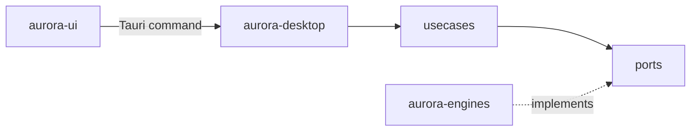

# Aurora Core

Domain model of the suite, the use cases and the ports every engine and surface goes through. Not built yet: this page describes the design of the foundations.

## Responsibilities

- The domain types: `Project`, `CycleState` (phase, plans and milestones, backlog summary, current release, release candidate, pull requests, pending gates, blocking bugs), `EngineKind` (Dev Cycle, Gedo, AnyContext), `EngineHealth` (installed, version, capabilities, status) and `InboxItem` (something waiting for the user's decision).
- The use cases, one per user action: list projects, add or remove a project, project overview, engine health, decision inbox; later agent work and questions.
- The ports the use cases need, as traits.
- It does not run processes, read files or know any UI framework; it compiles to WebAssembly so the interface shares its types.

## Structure

| Module | Holds |
|---|---|
| `domain` | the types above, plain data with serde |
| `ports` | `ProjectRegistry`, `CycleSource`, `CollaborationSource`, `KnowledgeSource`, `EngineProbe` |
| `usecases` | the operations, each taking the ports it needs |
| `capabilities` | which engine capabilities each feature needs, and the message when one is missing |

## Behavior

A use case asks `EngineProbe` which engines and capabilities exist, calls only the ports whose capabilities are present, and returns plain data with a status per section (ready, degraded with a reason, unavailable). Errors are values (`thiserror` enums), never panics.

## Interfaces

Called by `aurora-desktop` (one Tauri command per use case). Calls nothing outside itself: its ports are implemented by `aurora-engines`.

## Decisions

- [ADR-0001](../adr/0001-hexagonal-architecture-with-the-engines-behind-ports.md): hexagonal workspace, engines behind ports.
- [ADR-0003](../adr/0003-engines-integrated-only-through-their-command-lines-with-ver.md): capabilities decide which features run.
- [ADR-0004](../adr/0004-local-first-state-derived-from-the-repositories.md): the only own state is the project registry.
