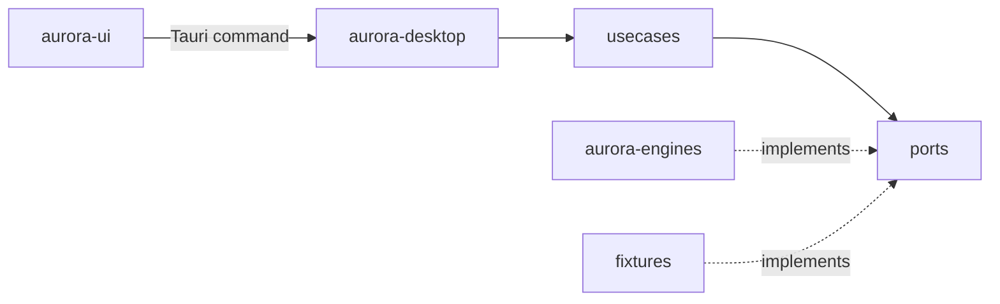

# Aurora Core

Domain model of the suite, the use cases and the ports every engine and surface goes through.

## Responsibilities

- The domain types of projects, engines, settings and features, as plain data with serde (`camelCase` on the wire).
- The use cases, one per user action: list, add, rename, remove and relocate a project; read and save the settings; probe an engine and build the engines overview.
- The ports the use cases need, as traits.
- The catalog of what each feature needs from each engine.
- Sample data and in-memory ports behind the `fixtures` feature, for every crate's tests and the interface preview.
- It does not run processes, read files or know any UI framework; it compiles to WebAssembly so the interface shares its types.

## Structure

| Module | Holds |
|---|---|
| `domain::project` | `Project`, `ProjectId`, `ProjectName` (trimmed, 1 to 80 characters), `Presence` (present or missing), `ProjectList` with an optional `RegistryNotice` (recovered or read-only), `AddOutcome`, `ProjectError` |
| `domain::engine` | `EngineKind` (`dcp`, `gedo`, `actx`), `EngineStatus` (ready, installed without contract, degraded with a reason, missing), `EngineReport`, `Capability`, `EngineSettings` (location, time limit) |
| `domain::settings` | `Settings` (version, `ThemeChoice`, per-engine settings) and `Theme` resolution |
| `domain::feature` | `Feature`, `AvailabilityState` (available, unavailable with what is missing and a hint, not in this release), `EnginesOverview` |
| `ports` | `ProjectRegistry`, `SettingsStore`, `EngineProbe` |
| `usecases` | `projects`, `settings`, `engines` |
| `capabilities` | the feature catalog and its evaluation |
| `fixtures` | feature `fixtures`: four sample projects (one missing), sample engine reports, `MemoryRegistry`, `MemorySettings`, `FixtureProbe` |

## Behavior

The catalog maps each feature to one engine, the capabilities it needs (schema MAJOR 1) and the release that ships it:

| Feature | Engine | Capabilities | Release |
|---|---|---|---|
| Portfolio, Project view, Decision inbox | Dev Cycle (`dcp`) | `diagnose` | v0.2.0 |
| Agent work | Gedo | `radar`, `scope`, `stream` | v0.4.0 |
| Knowledge | AnyContext (`actx`) | `ask`, `workspaces` | v0.5.0 |

A feature is unavailable, with the hint of its engine, while its engine is not ready or lacks a capability; only a ready engine counts, and only the capabilities of the engine the feature names. When everything is there but the feature ships in a later release, it says "not in this release". Errors are values (`thiserror` enums), never panics.

`CycleSource`, `CollaborationSource` and `KnowledgeSource` are added with the first release that calls them.

## Interfaces

Called by `aurora-desktop` (one Tauri command per use case) and, for the preview, by `aurora-ui` through the fixtures. Calls nothing outside itself. `cargo xtask arch-check` fails the build when the core depends on Tauri, Leptos, the adapters or process, file or network APIs.

## Decisions

- [ADR-0001](../adr/0001-hexagonal-architecture-with-the-engines-behind-ports.md): hexagonal workspace, engines behind ports.
- [ADR-0003](../adr/0003-engines-integrated-only-through-their-command-lines-with-ver.md): capabilities decide which features run.
- [ADR-0004](../adr/0004-local-first-state-derived-from-the-repositories.md): the only own state is the project registry and the settings.
