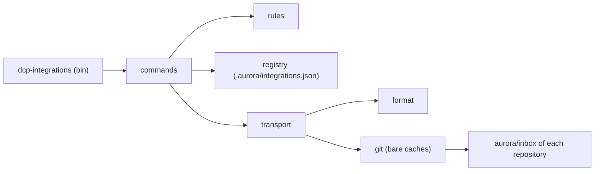

# Integrations Provider

dcp-integrations: messages between projects over each repository's aurora/inbox branch, with its format, conversation rules, Git transport and command line.

## Responsibilities

- Read and write the messages between projects on each repository's orphan `aurora/inbox` branch, with Git plumbing on bare caches, never touching a working tree.
- Hold the conversation rules (ADR-0009): kinds, templates, rounds, cycles, the closing record and who presents it to the user.
- Read the project's own registry, `.aurora/integrations.json`, and write it only for `init` and `add`.
- Answer every command in text and as versioned JSON (`--json`) for Aurora and other tools.
- It owns no user interface and makes no decision: the user decides, through Aurora or the command line.

## Structure

| Module | Holds |
|---|---|
| `format` | the message file: front matter (`id`, `kind`, `from`, `to`, `date`, `subject`, `status`, `reply_to`, `deferred`, `thread`, `cycle`, `round`, `needs_user`, `tool`), the body in `##` or `###` sections, parse and render; reads the files of the provisional tool 0.1 to 0.3 |
| `rules` | kinds that open and reply, the templates and their required sections, the current cycle, the next round, the round limit, the opener of a thread, the records waiting for the user, the closing record and its numbered options |
| `registry` | `.aurora/integrations.json` (`aurora.integrations` 1.0): the project's slug and repository and its counterparts; `init`, `add`, `load`, atomic `save` |
| `transport` | `ls-remote` without fetching, fetch into `<cache>/<project>.git` (one process at a time per cache through `<project>.git.lock`, waited for up to 60 s and removed when older than 2 minutes; the read-only commands `check`, `list`, `show`, `thread` and `record` reuse a fetch younger than 30 s, kept in the cache's `aurora-fetched` stamp, so Aurora's one command per project fetches each inbox once, while writes always fetch and leave the stamp on their own commit; with `--cached` they never fetch an inbox fetched before), one `ls-tree` and one `cat-file --batch` per inbox read, with the files of the tip read kept in `<project>.git/aurora-index.json` so a read of an unchanged tip runs no Git (ADR-0011), `sync` of one inbox (fetch unless younger than `--max-age`, then index), `inbox.json` MAJOR 1 checked before reading or writing, writes through a temporary index and `commit-tree`, pushed and rebuilt on the new tip up to 8 times when a push loses a race |
| `commands` | every command and its `--json` document (`dcp-integrations.<name>` 1.0), refusals with the missing sections, `watch` once per pass |
| `bin/dcp-integrations` | argument parsing by hand, `--dir`, `--json`, `--verbose`, exit codes |

## Behavior

**The branch.** Each repository's `aurora/inbox` branch holds only what that project received: `README.md`, `inbox.json` (`{"schema": "aurora.inbox", "schema_version": "1.0", "writer": ...}`) and `messages/<id>.md`. A branch written only by the provisional tool has no `inbox.json` and reads as 1.0; the provider adds it on its next write. Another MAJOR is refused for reading and for writing, with "update dcp-integrations".

**Reading.** A project sees what it received (its own inbox) and what it sent (its counterparts' inboxes, filtered by `from`). Messages are ordered by date, then id. Dates carry milliseconds; ids are `<YYYYMMDD-HHMMSS>-<from>-<slug>`, with a 4-hex suffix when taken.

**Writing.** Commits use the project's Git identity (`user.name`, `user.email` of the folder), or "dcp-integrations". A refusal writes nothing: an opening kind that is not question, proposal or notice, a reply kind that is not one, empty required sections, a message to itself, an unknown project, a fourth round. Reading a message (`show`) marks it seen.

**Rounds and cycles.** A round is one message from each side; `ack`, `notice`, `decision` and `guidance` are outside the rounds. After three rounds of the current cycle only an agreement or an impasse is accepted. A `guidance` (the user's request, from `guide` or `decide --revise`) starts the next cycle and closes the open records; the rounds count again from one.

**The user's turn.** An agreement or impasse sets `needs_user`. It waits for the user in the inbox of the project that opened the thread until a `decision` or a `guidance` follows it. `record` builds the closing record (projects, rounds, cycle, conclusion, justification, positions, open points, decision needed with its numbered options, after approval, the user's requests); `decide --choice` sends a `decision` to every other side and closes the record.

**Poll.** `poll` compares the inbox branch's remote tip (`ls-remote`) with the last tip seen, kept in the cache, and fetches only when it changed; it exits with 10 when there is news. `check` records the tip too, and lists the records waiting for the user, the pending messages, the sent messages still unread after the stale time and every conversation, most recent first. `defer` sets a message to seen with a `deferred: <reason>` note: it stays pending, so the next `check` lists it again, while `poll` counts only open messages.

**Not set up.** A command on a folder without `.aurora/integrations.json` fails with `not_set_up` (exit code 3). The error document carries the folder's `origin` in `repository` when it has one, so a reader such as Aurora can find the slug the other projects already give to that repository and suggest it for `init` (BUG-009).

**Sync.** `sync` fetches the project's inbox and every counterpart's at once, one thread per inbox, each unless fetched less than `--max-age` seconds ago (10 by default, so a sweep over projects that share counterparts fetches each inbox once), and indexes them; it reports per inbox the tip, whether it changed and why one could not be fetched. The reading commands with `--cached` then answer from the copies, and `check --cached` records the cached tip instead of running `ls-remote`. `version` declares the capability `cache` for this (ADR-0011).

**Summary.** A message may carry `summary` (FEAT-039, ADR-0013): one or two sentences in the first person for a reader at a glance, at most 280 characters, given with `--summary` on `send` and `reply` and refused when longer. It is written in the front matter after the fixed fields only when set (`summary: "..."`, line breaks folded into spaces), so a message without it is written exactly as before and tools 0.3 and earlier read it unchanged. `decide` writes "The user decided: <choice>" and `guide` "The user asks: <first sentence>". Every header in the replies carries `summary`, empty when none was written; documents are at schema 1.3 and `version` declares the capability `summary`.

**Export.** `export` answers `dcp-integrations.export`: the project, the registry's projects, and every conversation as `check` gives it with all its messages and its closing record when one exists, in one process (with `--cached`, from the copies). Each message carries its sections, its text and body without the status notes, and `notes`: the `> open|seen|done (date): note` lines the receiver appended, parsed with an ISO date. A closing record whose text has a `Recommended: <n>` line, or an option ending in "(recommended)", carries `recommended`. `version` declares the capability `export`; documents are at schema 1.2 (ADR-0012).

**Logs.** With `--verbose`, Git's error output goes to standard error. Bodies are never logged.

**Tests.** Unit tests cover the format (samples of tool 0.1 to 0.3), the rules and the registry. `tests/scenarios.rs` runs on bare repositories in a temporary folder: the transport (missing branch, first write, identity, a lost race rebuilt, `inbox.json` MAJOR 2 refused, an unreachable remote), a whole conversation from question to decision through a revision in cycle 2, `guide`, `check` with unread sent messages, `init`, `add`, `validate`, `watch` once, and the binary's exit codes. Every `--json` reply and every written file is validated against the contracts in `specs/008-messages/contracts`.

## Interfaces

The command line of [`contracts/cli.md`](../../specs/008-messages/contracts/cli.md), with the JSON of [`dcp-integrations.schema.json`](../../specs/008-messages/contracts/dcp-integrations.schema.json). Aurora runs it through `ProviderMessagesSource` (engines) and finds it next to its own executable first. It calls `git` only.

## Decisions

- [ADR-0007](../adr/0007-cross-project-integrations-through-git-on-an-orphan-inbox-br.md): messages through Git on an orphan inbox branch per repository.
- [ADR-0009](../adr/0009-conversations-between-projects-in-rounds-that-close-with-a-r.md): conversations in rounds and cycles that close with a record for the user.
- [ADR-0010](../adr/0010-the-integrations-provider-ships-with-aurora-and-the-inbox-br.md): the provider ships with Aurora and alone; each project lists its counterparts; the branch holds only data and its format version.
- [ADR-0011](../adr/0011-messages-are-read-from-local-inbox-copies-kept-current-by-a.md): reads answer from local copies indexed per tip, kept current by `sync`.
- [ADR-0012](../adr/0012-a-messages-worker-in-aurora-owns-every-provider-call-and-ser.md): `export` gives a whole reading in one call for Aurora's messages worker.
- [ADR-0013](../adr/0013-messages-read-as-a-chat-between-projects-with-a-summary-writte.md): the sender's summary in the message header.
- [ADR-0003](../adr/0003-engines-integrated-only-through-their-command-lines-with-ver.md): Aurora uses it only through its command line with versioned JSON.
- [ADR-0014](../adr/0014-aurora-is-a-self-hosted-web-application-governed-by-the-levi.md): integration approvals are attestations signed by the Admin Hub, written to the inboxes and verified offline.
- [ADR-0015](../adr/0015-integrations-coordinator-round-tables-approvals-by-every-inv.md): round tables chaired by the coordinator, approvals by every involved project, the integration hold and the verify check at merge.
- [ADR-0016](../adr/0016-the-integrations-coordinator-runs-in-dcp-integrations-dcp-gi.md): the phase-check judgment, the round table, `verify` and the mail fallback run in dcp-integrations as `dcp integrations ...`; dcp gives the phase points and enforces the hold.
